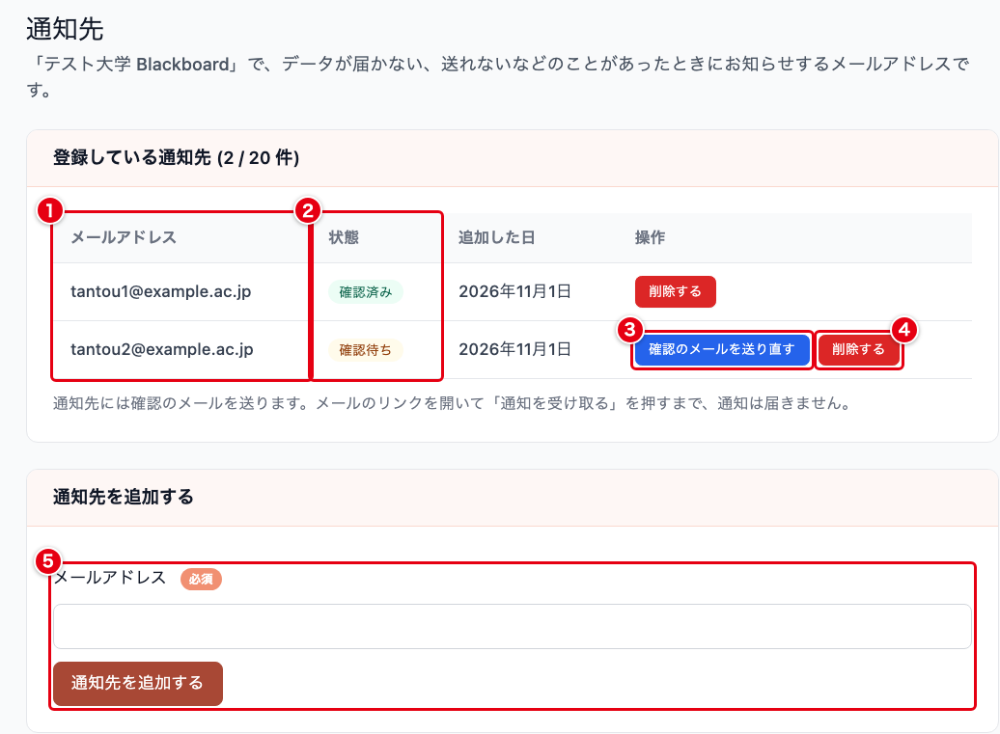
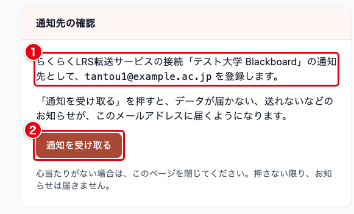

# らくらくLRS転送サービス：通知先と通知メール

このページは、らくらくLRS転送サービスで、データが届かない、送れないなどのことが起きたときにお知らせを受け取るメールアドレス（通知先）の登録と、届くお知らせのメールの種類を説明します。
接続の作り方は [らくらくLRS転送サービス](lrs-relay/lrs-relay.md) にあります。

> 画面図の赤い枠と丸数字は、そのすぐ下にある表の番号に対応しています。
> 番号の順に読むと、その画面で何を入力し、どのボタンを押すのかが分かります。

## 通知先とは

通知先は、接続ごとに登録するメールアドレスです。
登録すると、そのメールアドレスに確認のメールが届きます。
メールのリンクを開いて「通知を受け取る」を押すまでは、お知らせは届きません。
本人が確かめてから送ることで、打ち間違えたアドレスや、関係のない人のアドレスへお知らせが届かないようにしています。

お知らせのメールは、確認が済んだ通知先のほか、SEC の運用担当者にも届きます。

## 1. 通知先を登録する

接続の詳細の画面で「通知先」を押すと、通知先の画面が開きます。

| 番号 | 項目 | 必須 | 説明 |
| --- | --- | :---: | --- |
| ① | メールアドレス | | 登録している通知先のメールアドレスです |
| ② | 状態 | | 確認が済んだ通知先は「確認済み」、まだ済んでいない通知先は「確認待ち」です。お知らせが届くのは「確認済み」の通知先だけです |
| ③ | 確認のメールを送り直す | | 「確認待ち」の通知先にだけ表示されます。確認のメールを、新しいリンクで送り直します |
| ④ | 削除する | | 通知先を削除します。確認が表示されます |
| ⑤ | メールアドレス | ✓ | 追加するメールアドレスを入力し、「通知先を追加する」を押します。254 文字まで入力できます |

「通知先を追加する」を押すと、「確認のメールを送りました。メールのリンクを開いて確認が済むと、通知が始まります。」と表示され、入力したメールアドレスに確認のメールが届きます。
メールアドレスは、英字を小文字にして登録します。

通知先は、1 つの接続に 20 件まで登録できます。
20 件に達すると、追加の欄のかわりに「1 つの接続に登録できる通知先は 20 件までです。追加するには、使っていない通知先を削除してください。」と表示されます。
同じ接続に同じメールアドレスは登録できず、「このメールアドレスは、すでに通知先にあります。」と表示されます。

確認のメールは、送りすぎを防ぐため、送れる回数に上限があります。

- 同じ接続の同じメールアドレスへは、10 分に 1 通まで。追加したときの確認のメールも数えます
- 同じメールアドレスへは、1 時間に 6 通まで、1 日に 10 通まで。ほかの接続から送った確認のメールも数えます
- 組織の接続からは、合わせて 1 時間に 30 通まで

上限に達すると、「確認のメールは 10 分おきに送り直せます。少し待ってから、もう一度お試しください。」や「このメールアドレスへ送る確認のメールが、1 時間の上限に達しました。」のように表示されます。

「削除する」を押すと、「◯◯ を通知先から削除します。」「元に戻すには、もう一度追加して、そのアドレスで確認してもらう必要があります。」と表示されます。
「削除する」をもう一度押すと削除されます。

## 2. 確認のメールから通知を受け取る

通知先として登録されたメールアドレスには、「【Shinonome Education Cloud】らくらくLRS転送サービスの通知先の確認」という件名のメールが届きます。
件名の【】の中は、ご利用の環境によって別の名前になることがあります。
メールには、組織の名前と接続の名前、確認の画面へのリンク、リンクの期限が書かれています。
リンクの期限は、メールを送ってから 72 時間です。

リンクを開くと、次の画面が表示されます。

| 番号 | 項目 | 説明 |
| --- | --- | --- |
| ① | 登録の内容 | どの接続の通知先として、どのメールアドレスを登録するかが表示されます |
| ② | 通知を受け取る | 押すと確認が済み、このメールアドレスにお知らせが届くようになります |

この画面は、SEC にログインしていなくても開けます。
**リンクを開いただけでは、確認は済みません。**
「通知を受け取る」を押すと「通知先として登録しました」と表示され、通知先の画面の状態が「確認済み」になります。
心当たりがないときは、何も押さずに画面を閉じてください。

期限が切れたリンクや、確認が済んだあとのリンク、送り直す前の古いリンクを開くと、「このリンクは使えません」「期限が切れているか、すでに確認が済んでいます。」と表示されます。
期限が切れたときは、接続の管理者に、通知先の画面から確認のメールを送り直してもらってください。

## 3. 届くお知らせのメール

SEC は、5 分ごとに各接続の状況を Cloudflare から取得し、次の表の状態になっていればお知らせのメールを送ります。
件名はどれも「【Shinonome Education Cloud】」で始まります（【】の中は、ご利用の環境によって別の名前になることがあります）。
本文には、組織の名前、接続の名前、検知した日時、何が起きたか、データがどうなるか、することと、接続の詳細の画面へのリンクが書かれています。

| 件名（【】のあと） | 送るとき | すること |
| --- | --- | --- |
| CampusLA にデータを送れていません | 送れていないデータがあり、「最後に送れた時刻」と「最も古い未送信のデータを受け取った日時」の新しいほうから 30 分たったとき。送信を一時停止している接続には送りません | CampusLA が動いているか、送信先の URL、API キー、秘密キーが合っているかを確かめます |
| CampusLA の認証情報が違うため、送信を止めています | CampusLA が API キーと秘密キーを受け付けず、送信を止めたとき | 接続の編集画面で、CampusLA の API キーと秘密キーを直して保存します |
| 送信先の証明書を確かめられないため、送信を止めています | CampusLA の証明書を確かめられず、送信を止めたとき | CampusLA の運用担当者に、証明書の期限と送信先の URL を確かめてもらいます |
| 送信先の設定に問題があるため、送信を止めています | CampusLA が別の場所へ移動したという応答（3xx）を返したときや、送信先の設定に誤りがあって送信を止めたとき | 接続の編集画面で、送信先の URL を確かめて保存します |
| 送れていないデータが N 日以上残っています（7 日で消えます） | 最も古い未送信のデータを受け取ってから、1 日、3 日、6 日たったとき。受信や送信を止めている接続にも送ります | CampusLA が動いているかと、送信失敗の理由を確かめます。7 日たったデータは消え、送り直せません |
| 送れなかったデータが新しく見つかりました | 直近 1 時間に、拒否、保留、送信失敗のデータが 1 件以上あったとき。対象外は数えません | 「送れなかったデータ」の画面で理由を確かめ、メールアドレスの作り方や送る役割の設定を直します |
| データを保存できませんでした | Cloudflare にデータを保存できず、LMS に 503 を返したとき | 接続の画面で保存容量と未送信の件数を確かめます。保存できなかったデータは、LMS が送り直さない限り届きません |
| 保存容量の使用量が N% になりました | Cloudflare の保存容量の使用量が、上限（10 GB）の 7 割以上になったとき | 未送信のデータが溜まっていないかを確かめ、溜まっていれば先に CampusLA への送信を直します |
| N 時間以上、データを受け取っていません | 接続の「受信が途絶えたとき通知するまでの時間」のあいだ、LMS から何も届かなかったとき。一度も受け取っていない接続は、接続を作った日時から数えます。受信を停止している接続には送りません | LMS からの送信が動いているか、LMS の送り先の URL や API キー、送信元の IP アドレスが変わっていないかを確かめます |
| 解消しました: （解消した状態） | 上の状態のお知らせを送ったあと、その状態が 30 分続けて見られなくなったとき | 対応は要りません。念のため接続の画面で状況を確かめます |

「送れなかったデータが新しく見つかりました」の本文には、役割が書かれていないことが原因の保留があったかどうかも書かれます。
あった場合は、送る役割と、役割が書かれていないデータの扱いを見直すよう案内しています。

### 同じお知らせの間隔

- 同じ接続の同じ状態のお知らせは、状態が続いていても 6 時間に 1 通までです
- 「送れなかったデータが新しく見つかりました」だけは、1 時間に 1 通までです
- 「送れていないデータが N 日以上残っています」は、1 日、3 日、6 日のうち、いちばん長いものだけを送ります。日数が進んだときは、6 時間を待たずに送ります
- 「送れなかったデータが新しく見つかりました」と「データを保存できませんでした」には、「解消しました」のメールはありません
- 状態が一度解消したあと、前のお知らせから 6 時間（「送れなかったデータが新しく見つかりました」は 1 時間）たたないうちにまた起きたときは、すぐには送りません。前のお知らせから 6 時間（1 時間）たった時点で状態が続いていれば、そのときに送ります

### SEC の運用担当者だけに届くお知らせ

SEC から Cloudflare に状況を問い合わせられない状態が 30 分続くと、「[管理者向け] Cloudflare の Worker から状況を取得できません」という件名のお知らせを、SEC の運用担当者にだけ送ります。
通知先には届きません。
この間、ほかのお知らせは送られませんが、受け取ったデータは Cloudflare に保管されています。
