# らくらくLRS転送サービス

このページは、らくらくLRS転送サービスの接続を作り、送れているかを確かめる組織管理者に向けて、操作の手順を説明します。
通知先の登録とお知らせのメールは [通知先と通知メール](lrs-relay/lrs-relay-notifications.md) に、Caliper のデータを xAPI にする規則は [Caliper から xAPI への変換](lrs-relay/caliper-xapi-conversion.md) にあります。

> 画面図の赤い枠と丸数字は、そのすぐ下にある表の番号に対応しています。
> 番号の順に読むと、その画面で何を入力し、どのボタンを押すのかが分かります。

## らくらくLRS転送サービスとは

らくらくLRS転送サービスは、LMS（Blackboard など）が送る学習データを受け取り、CampusLA へ転送するサービスです。
LMS は学習データを Caliper という形式で送り、CampusLA は xAPI という形式でしか受け取れません。
このサービスが、受け取った Caliper を xAPI に変えて CampusLA へ送ります。

- LMS 1 つにつき、接続を 1 つ作ります。接続ごとに、受け口の URL と API キーが決まります
- CampusLA は学習者をメールアドレスで見分けます。LMS のデータのどの値からメールアドレスを作るかを、接続ごとに決めます
- 受け取ったデータは Cloudflare 上に暗号化して保管し、CampusLA へ順に送ります。CampusLA が止まっていても受け取りは続け、送れるようになると自動で送ります
- 受け取ったデータは、受け取ってから 7 日たつと、送れていなくても消えます

SEC の画面で行うのは、接続の設定、状況の確認、再送、通知の設定です。
学習データの中身は SEC の画面に表示されません。
画面に出るのは、件数、理由、イベント ID、日時、送信元の IP アドレスと、メールアドレスの作り方を試したときの一部を伏せた例だけです。

## ご利用の前に

らくらくLRS転送サービスは、組織で契約して使うサービスです。
個人では契約できません。

使えるのは、契約した組織の組織管理者のうち、「LMS連携設定管理」の権限を与えられている方です。
組織から外れた管理者は、権限が残っていても使えません。

**このサービスは、ダッシュボードのサービス一覧には表示されません。**
SEC にログインしたあと、ブラウザのアドレス欄に SEC の URL の後ろに `/lrs-relay/connections` を付けたアドレスを入れて開きます（例：`https://app.yu-kara.io/lrs-relay/connections`）。
開くと「接続の一覧」の画面が表示されます。

始める前に、次のものを用意してください。

- CampusLA の statements の URL（例：`https://lrs.example.ac.jp/xapi/statements`）
- CampusLA（SQL LRS）で作った、statements/write の権限だけを持つ API キーと秘密キー
- LMS で Caliper の送り先と API キーを設定できる方の協力

読み出しや削除の権限がある CampusLA のキーは使わないでください。
キーが外に漏れたときに、データを読み出されたり消されたりしないようにするためです。

手順は次の順に進めます。

1. 接続を作る
2. 受信用の API キーを発行する
3. 受信を始める
4. LMS に受け口の URL と API キーを設定する
5. メールアドレスの作り方を試す
6. 状況を確かめる

## 接続の一覧

`/lrs-relay/connections` を開くと、作った接続が名前の順に並びます。
件数は直近 24 時間のものです。

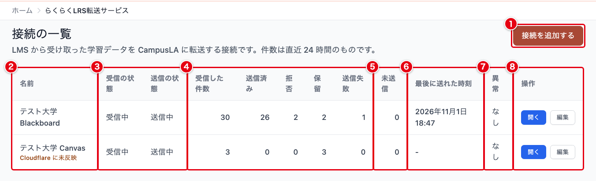

| 番号 | 項目 | 説明 |
| --- | --- | --- |
| ① | 接続を追加する | 接続を作る画面に移動します。手順は「1. 接続を作る」にあります |
| ② | 名前 | 接続の名前です。押すと接続の詳細の画面に移動します。設定がまだ Cloudflare に反映されていない接続には「Cloudflare に未反映」と表示されます（「6. 状況を確かめる」） |
| ③ | 受信の状態、送信の状態 | 受信は「受信中」か「停止中」、送信は「送信中」か「一時停止中」です（「3. 受信を始める」） |
| ④ | 件数 | 受信した件数、送信済み、拒否、保留、送信失敗の件数です。受信した件数に、拒否したデータは入りません。対象外の件数は、接続の詳細の画面に表示されます |
| ⑤ | 未送信 | まだ送信の処理が済んでいない件数です。1 件以上あれば、そのうち最も古いデータを受信した日時も表示されます |
| ⑥ | 最後に送れた時刻 | CampusLA へ最後にデータを送れた日時です。まだ送れていなければ「-」です |
| ⑦ | 異常 | 送信を止めているときは「送信が止まっています」、最後に送れた時刻より後にエラーが起きているとき（まだ一度も送れていないときを含む）は「直近のエラーあり」、どちらでもなければ「なし」です。CampusLA がデータの内容を受け付けず「送信失敗」にしたデータは、ここには表れません。④の送信失敗の件数で確かめます |
| ⑧ | 操作 | 「開く」で接続の詳細の画面、「編集」で接続の編集画面に移動します |

Cloudflare から状況を取得できなかった接続は、④から⑥の欄に「状況を取得できません」と表示され、⑦は空欄になります。

拒否、保留、対象外、送信失敗の意味は次のとおりです。

- 拒否：受け取る時点で、Caliper の形が正しくないと判断したデータです
- 保留：CampusLA へ送るメールアドレスを作れなかったなどの理由で、送らずに残しているデータです
- 対象外：「CampusLA に送る役割」に入っていないため、送らなかったデータです
- 送信失敗：CampusLA が受け取らなかったデータです

## 1. 接続を作る

接続の一覧で「接続を追加する」を押すと、「接続を追加」の画面が開きます。
入力欄は 6 つの欄に分かれています。

### 名前と受信の設定

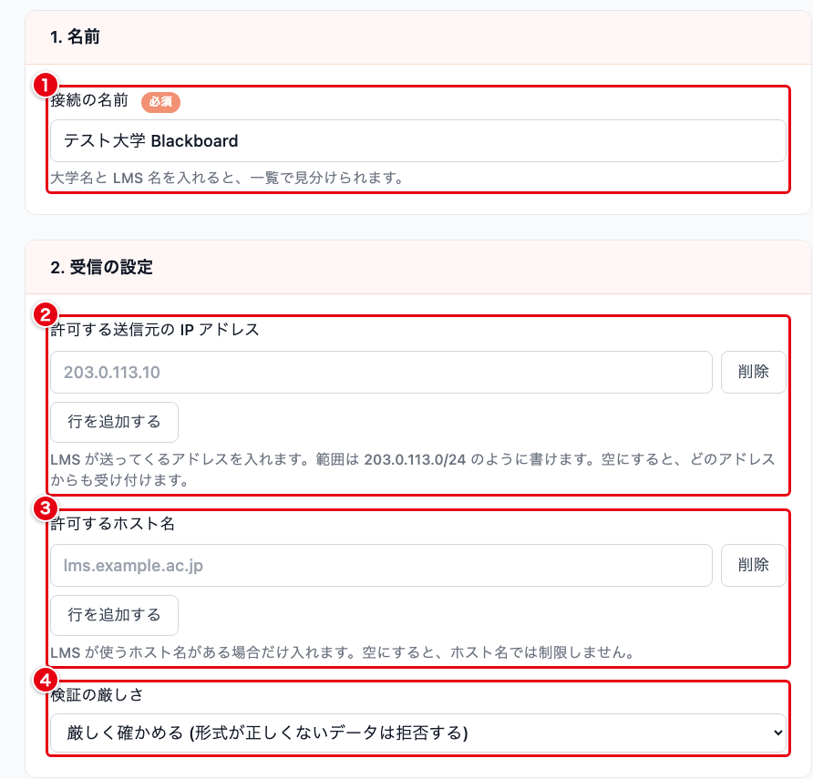

| 番号 | 入力項目 | 必須 | 説明 |
| --- | --- | :---: | --- |
| ① | 接続の名前 | ✓ | 接続の名前です（例：テスト大学 Blackboard）。120 文字まで入力できます。大学名と LMS 名を入れると、一覧で見分けられます |
| ② | 許可する送信元の IP アドレス | | LMS がデータを送ってくる IP アドレスです。1 行に 1 つ入力し、「行を追加する」で行を増やします。IPv4 と IPv6 のアドレスと、203.0.113.0/24 のような範囲を入力できます。50 件まで登録できます |
| ③ | 許可するホスト名 | | LMS のホスト名です（例：lms.example.ac.jp）。20 件まで登録できます。IP アドレスや、`.` を含まない名前は入力できません |
| ④ | 検証の厳しさ | | 受け取った Caliper をどこまで厳しく確かめるかを選びます。初期値は「厳しく確かめる (形式が正しくないデータは拒否する)」です |

②と③の両方を空にすると、送信元を確かめず、API キーだけで受け付けます。
どちらかを入力すると、②の IP アドレスか、③のホスト名を引いて得た IP アドレスのどれかに一致する送信元からだけ受け付けます。
それ以外の送信元から届いたデータは受け付けず、接続の詳細の画面の「拒んだ送信元」に IP アドレスが残ります（「9. 送信元を確かめる、追加する」）。

③のホスト名は、受け取るたびに Cloudflare の DNS で IP アドレスを引いて確かめます。
引いた結果は、最長 5 分のあいだ使い回します。
LMS が、ホスト名の IP アドレスとは別のアドレスからデータを送ってくる場合は、②に IP アドレスで登録してください。

④の「厳しく確かめる」と「ゆるく確かめる (多少の違いは受け付ける)」の違いは、[Caliper から xAPI への変換](lrs-relay/caliper-xapi-conversion.md) の「「厳しく確かめる」と「ゆるく確かめる」」にあります。

### 送る役割とメールアドレスの作り方

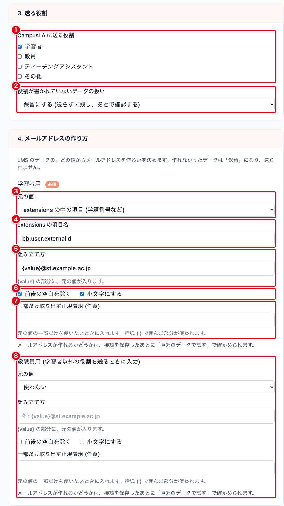

| 番号 | 入力項目 | 必須 | 説明 |
| --- | --- | :---: | --- |
| ① | CampusLA に送る役割 | ✓ | 学習者、教員、ティーチングアシスタント、その他から、CampusLA へ送る役割を選びます。1 つ以上選びます。初期値は学習者だけです。選ばなかった役割のデータは「対象外」になります |
| ② | 役割が書かれていないデータの扱い | | LMS のデータに役割が書かれていないときの扱いです。「保留にする (送らずに残し、あとで確認する)」「学習者として送る」「送らない」から選びます。初期値は「保留にする」です |
| ③ | 元の値（学習者用） | ✓ | メールアドレスを作る元にする値を、「メールアドレス (otherIdentifiers の EmailAddress)」「ID の末尾 (Person の id の、最後の / より後ろ)」「extensions の中の項目 (学籍番号など)」から選びます。初期値は「ID の末尾」です |
| ④ | extensions の項目名 | | ③で「extensions の中の項目」を選んだときだけ表示され、そのときは必須です。LMS のデータの学習者の extensions の中の、元にする項目の名前を入力します（例：bb:user.externalId）。100 文字まで入力できます |
| ⑤ | 組み立て方 | ✓ | メールアドレスの形を入力します（例：{value}@st.example.ac.jp）。{value} の部分に元の値が入ります。{value} をちょうど 1 つ含め、200 文字まで入力できます。③で「メールアドレス」を選び、その値をそのまま使うときは {value} とだけ入力します |
| ⑥ | 前後の空白を除く、小文字にする | | 元の値の前後の空白を除くか、英字を小文字にするかを選びます。学習者用は、初期状態で両方にチェックが入っています |
| ⑦ | 一部だけ取り出す正規表現 | | 元の値の一部だけを使いたいときに入力します。括弧 ( ) で囲んだ部分が使われます（例：`S(\d+)` は `S2026001` から `2026001` を取り出します）。半角の英数字と記号で、100 文字まで入力できます |
| ⑧ | 教職員用 | | 学習者以外の役割（教員、ティーチングアシスタント、その他）のデータに使う作り方です。入力欄は学習者用と同じです。使わないときは「元の値」を「使わない」のままにします |

①で学習者以外の役割を選んだのに⑧が空のまま保存すると、「教職員など学習者以外の役割を送る設定ですが、教職員用のメールアドレスの作り方が空です。該当するデータは「保留」になり、送られません。」と表示されます。
保存はできますが、その役割のデータは保留になります。

メールアドレスを作れなかったデータは、保留になり、CampusLA へ送られません。
作り方の規則の詳細は、[Caliper から xAPI への変換](lrs-relay/caliper-xapi-conversion.md) の「学習者の決め方」にあります。
作り方が LMS のデータに合っているかは、接続を保存したあとに確かめられます（「5. メールアドレスの作り方を試す」）。

⑦の正規表現は、処理が終わらなくなる書き方を防ぐため、使える書き方を制限しています。
たとえば、後方参照（`\1` など）や、量指定子を含む `( )` をさらに繰り返す書き方は使えません。
繰り返しの指定（`*`、`+`、`?`、`{n,m}`）は全部で 4 つまで、そのうち `+` や `*` は 1 つまでです。

### 送信先と通知

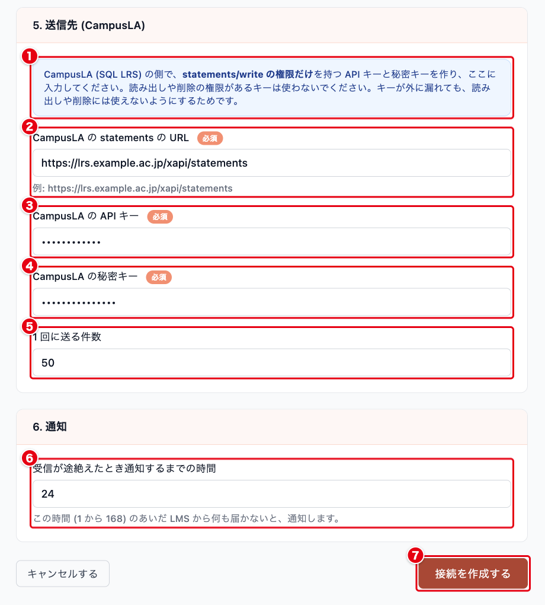

| 番号 | 入力項目 | 必須 | 説明 |
| --- | --- | :---: | --- |
| ① | キーについての案内 | | CampusLA（SQL LRS）の側で、statements/write の権限だけを持つ API キーと秘密キーを作るよう案内しています。キーが外に漏れても、読み出しや削除に使えないようにするためです |
| ② | CampusLA の statements の URL | ✓ | CampusLA の statements の URL を、statements まで含めて入力します（例：https://lrs.example.ac.jp/xapi/statements）。https:// で始まる URL だけを入力できます |
| ③ | CampusLA の API キー | ✓ | CampusLA で作った API キーです。入力した値は画面に表示されません |
| ④ | CampusLA の秘密キー | ✓ | CampusLA で作った秘密キーです。入力した値は画面に表示されません |
| ⑤ | 送信先の IP アドレス | | CampusLA の IP アドレスが固定のときだけ入力します。1 行に 1 つ、範囲ではなく 1 つのアドレスを入力します。50 件まで登録できます。空にすると、URL のホスト名から接続先を探します |
| ⑥ | 1 回に送る件数 | | CampusLA へ 1 回にまとめて送る件数です。1 から 500 まで入力できます。初期値は 50 です |
| ⑦ | 受信が途絶えたとき通知するまでの時間 | | この時間のあいだ LMS から何も届かないと、通知先にお知らせのメールを送ります。1 から 168 まで、時間の単位で入力します。初期値は 24 です |
| ⑧ | 接続を作成する | | 接続を作成し、接続の詳細の画面に移動します |

②の URL は、次の場合は保存できません。

- URL にユーザー名やパスワードを含めた場合（キーは③と④に入力します）
- 社内用や予約済みの IP アドレスを指す場合
- ホスト名から IP アドレスを引けない場合

⑤の IP アドレスを入力すると、URL のホスト名で IP アドレスを引かずに、入力したアドレスへつなぎます。
証明書は URL のホスト名で確かめます。
CloudFront やロードバランサの配下で CampusLA のアドレスが変わる場合に入力すると、アドレスが変わった時点で送れなくなります。
社内用や予約済みのアドレスと、Cloudflare のアドレスは入力できません。

⑧を押すと「接続を作成しました。Cloudflare への反映を始めています。」と表示されます。
**作ったばかりの接続は「受信: 停止中」です。**
LMS からのデータは、API キーを発行して受信を始めるまで受け付けません。

## 2. 受信用の API キーを発行する

LMS が接続へデータを送るときに使う API キーを発行します。
CampusLA の API キーとは別のものです。

接続の詳細の画面の「受信」の欄で「API キーを発行する」を押すと、次の画面が表示されます。

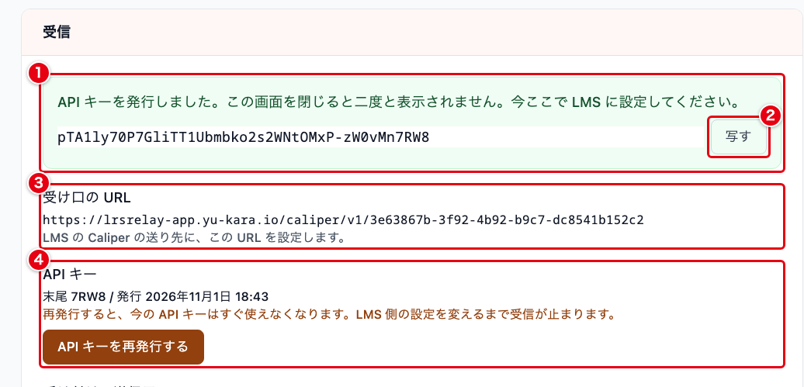

| 番号 | 項目 | 説明 |
| --- | --- | --- |
| ① | 発行した API キー | 発行した API キーです。この画面にだけ表示されます |
| ② | 写す | API キーをクリップボードにコピーします。コピーすると「コピーしました。」と表示されます |
| ③ | 受け口の URL | LMS が Caliper のデータを送る先の URL です。URL の最後の部分は接続ごとに決まります |
| ④ | API キー | 発行した API キーの末尾 4 文字と、発行した日時です。「API キーを再発行する」で、新しい API キーを発行します |

**API キーは、発行した直後のこの画面に 1 回だけ表示されます。**
画面を閉じたり、ほかの画面に移ったりすると、二度と表示されません。
SEC にも、API キーそのものは残りません。
表示されているうちに LMS に設定するか、安全な場所に控えてください。

API キーをなくしたときは、「API キーを再発行する」を押します。
「API キーを再発行します。今の API キーはすぐ使えなくなり、LMS 側の設定を変えるまで受信が止まります。よろしいですか。」と確認が表示されます。
再発行すると、新しい API キーが Cloudflare に反映された時点で、今の API キーでは受け付けなくなります。
LMS 側の API キーも、新しいものに変えてください。

## 3. 受信を始める

API キーを発行したら、接続の詳細の画面の「受信と送信の状態」の欄で、受信を始めます。

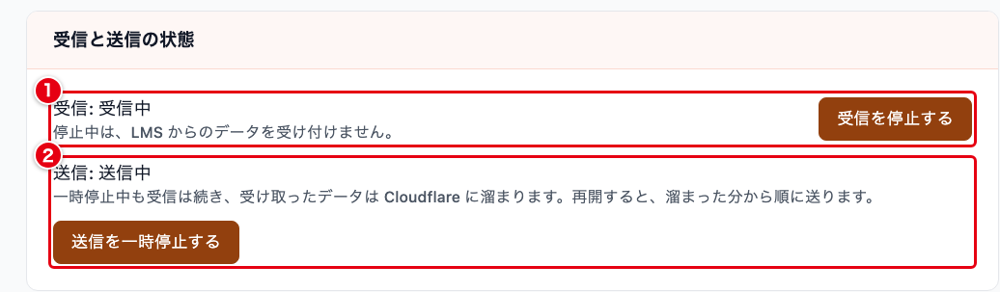

| 番号 | 項目 | 説明 |
| --- | --- | --- |
| ① | 受信 | 「受信中」か「停止中」です。「受信を始める」で受信を始め、「受信を停止する」で止めます。API キーを発行するまでは「受信を始める」を押せません |
| ② | 送信 | 「送信中」か「一時停止中」です。「送信を一時停止する」で CampusLA への送信を止め、「送信を再開する」で再開します。作ったばかりの接続は「送信中」です |

受信を停止している間は、LMS からのデータを受け付けません。
LMS には、時間をおいて送り直すよう求める応答（503）を返します。
停止中に受け付けなかったデータは、LMS が送り直さない限り届きません。

送信を一時停止している間も、受信は続き、受け取ったデータは Cloudflare に溜まります。
再開すると、溜まった分から順に送ります。
**一時停止している間も、受け取ってから 7 日たったデータは消えます。**
一時停止している間は、再送も進みません。

## 4. LMS に受け口の URL と API キーを設定する

LMS の Caliper の送り先に、「2. 受信用の API キーを発行する」で表示された受け口の URL と API キーを設定します。
LMS の画面での操作は、お使いの LMS の説明書をご覧ください。

らくらくLRS転送サービスが LMS に求める送り方は次のとおりです。

- 受け口の URL へ、`POST` で送ります
- API キーは、`Authorization` ヘッダーに `Bearer <API キー>` の形で入れます。`Bearer` を付けずに API キーだけを入れても受け付けます
- `Content-Type` は `application/json` にします（`/json` か `+json` を含む値なら受け付けます。大文字と小文字は区別しません）
- Caliper 1.1 か 1.2 の Envelope を送ります。1 回に送るデータは 5 MiB まで、`data` の要素は 5000 個まで、イベント 1 件は 256 KiB までです

受け口が LMS に返す応答は次のとおりです。

| 応答 | 返す場合 |
| --- | --- |
| 200 | イベントを 1 件以上受け付けたとき。Envelope にイベントが 1 件も無いときも 200 です |
| 400 | Envelope の形が正しくないとき。または、Envelope の中のイベントがすべて拒否になったとき |
| 401 | API キーが違うとき |
| 403 | 許可していない送信元から届いたとき |
| 404 | 受け口の URL が違うとき。または、接続の設定がまだ Cloudflare に届いていないとき |
| 413 | 1 回に送るデータが 5 MiB を超えたとき。または、`data` の要素が 5000 個を超えたとき |
| 415 | `Content-Type` に `/json` も `+json` も含まれないとき |
| 503 | 受信を停止しているとき。許可するホスト名の IP アドレスを引けず、送信元を確かめられないとき。Cloudflare に保存できなかったとき。Cloudflare 側で接続の設定を読み取れないとき。どの場合も `Retry-After` ヘッダーで、送り直すまでの秒数を返します |

200 と、イベントがすべて拒否になったときの 400 は、本文に受け付けた件数（`accepted`）、保留にした件数（`held`）、対象外にした件数（`excluded`）と、拒否したイベントの一覧（`rejected`）を JSON で返します。
拒否したイベントの一覧には、Envelope の `data` の何番目か（0 から数えます）、イベントの `id`、拒否した理由が入ります。
`id` を整数で書いたイベントは、その数字を文字にしたもの（`12345` なら `"12345"`）が入ります。

```json
{"accepted":21,"held":2,"excluded":1,"rejected":[{"index":23,"id":"evt-0001","reason":"id_not_uuid"}]}
```

1 件でも拒否になったイベントがあっても、ほかのイベントは受け付けます。
拒否の理由は [Caliper から xAPI への変換](lrs-relay/caliper-xapi-conversion.md) の「拒否するイベント」にあります。

## 5. メールアドレスの作り方を試す

LMS からデータが届き始めたら、メールアドレスの作り方が LMS のデータに合っているかを確かめます。
接続の詳細の画面で「設定を編集する」を押し、「4. メールアドレスの作り方」の欄の「直近のデータで試す」を押します。

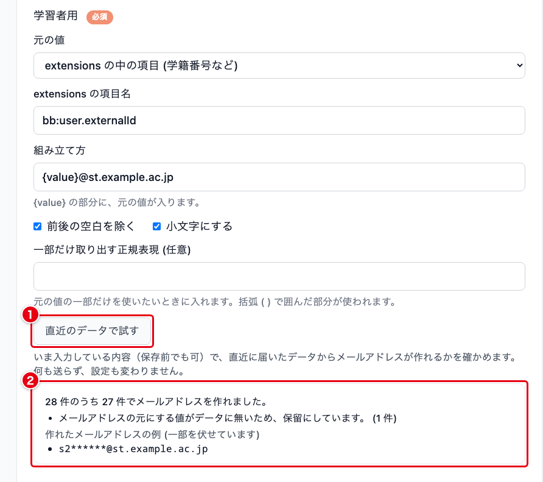

| 番号 | 項目 | 説明 |
| --- | --- | --- |
| ① | 直近のデータで試す | いま入力している作り方で、直近に届いたデータからメールアドレスを作れるかを確かめます。保存する前の入力でも試せます。何も送らず、設定も変わりません |
| ② | 試した結果 | 試した件数のうち、メールアドレスを作れた件数です。作れなかったデータは、理由ごとの件数が表示されます。作れたメールアドレスの例が 3 件まで、{value} に入った値の先頭 2 文字のほかを * に伏せて表示されます |

試す対象は、直近に受け取ったデータ 100 件までのうち、役割が合うものです。

- 学習者用の「直近のデータで試す」は、役割が学習者のデータ（成績のデータを含む）に当てます
- 教職員用の「直近のデータで試す」は、役割が教員、ティーチングアシスタント、その他のデータに当てます
- 役割が書かれていないデータは、Cloudflare に反映済みの設定で「役割が書かれていないデータの扱い」が「学習者として送る」のときだけ、学習者用で試す対象に入ります。この扱いを変えたときは、先に保存し、「Cloudflare に未反映」の表示が消えてから試してください
- 拒否したデータは、試す対象に入りません

試せるデータが無いときは「試せるデータがまだ届いていません。」と表示されます。
「直近のデータで試す」は、保存したあとの接続の編集画面にだけあります。

作り方を直して「保存する」を押すと、そのあとに受け取ったデータから新しい作り方が使われます。
すでに保留になったデータは、そのままでは送られません。
「8. 再送する」で、対象を「送れていないもの」にして再送すると、今の作り方で作り直して送ります。

## 6. 状況を確かめる

接続の一覧で接続の名前か「開く」を押すと、接続の詳細の画面が開きます。
画面の上には、接続の名前と、ほかの画面への入口があります。

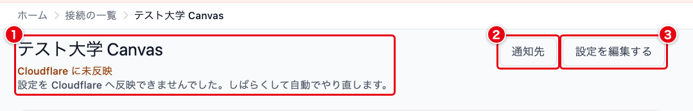

| 番号 | 項目 | 説明 |
| --- | --- | --- |
| ① | 名前と反映の状態 | 接続の名前です。設定がまだ Cloudflare に反映されていないときは「Cloudflare に未反映」と表示されます。反映に失敗したときは、その下に案内が表示されます |
| ② | 通知先 | 通知先の画面に移動します。手順は [通知先と通知メール](lrs-relay/lrs-relay-notifications.md) にあります |
| ③ | 設定を編集する | 接続の編集画面に移動します（「10. 接続を編集する、削除する」） |

### 「Cloudflare に未反映」と表示されたとき

設定を保存したり、受信や送信を止めたり再開したりすると、その設定を Cloudflare へ反映します。
反映が済むまでの間と、反映に失敗したときに、「Cloudflare に未反映」と表示されます。
反映が済むまでは、Cloudflare は前の設定のまま受信と送信を続けます。

反映に失敗したときは、「設定を Cloudflare へ反映できませんでした。しばらくして自動でやり直します。」と表示されます。
原因によっては、さらに次の案内が表示されます。

| 案内 | すること |
| --- | --- |
| 転送の仕組みの準備がまだ済んでいません。運用担当者に連絡してください。 | 運用担当者に連絡してください |
| Cloudflare 側との連携の設定が合っていません。運用担当者に連絡してください。 | 運用担当者に連絡してください |
| 送信先の URL か固定する IP アドレスを Cloudflare 側が受け付けませんでした。「設定を編集する」から見直して保存し直してください。 | 送信先の URL と送信先の IP アドレスを見直して、保存し直してください |
| 設定の内容を Cloudflare 側が受け付けませんでした。「設定を編集する」から見直して保存し直してください。 | 設定を見直して、保存し直してください |

### 状況の欄

接続の詳細の画面の「状況」の欄に、受け取ったデータと送ったデータの件数が表示されます。

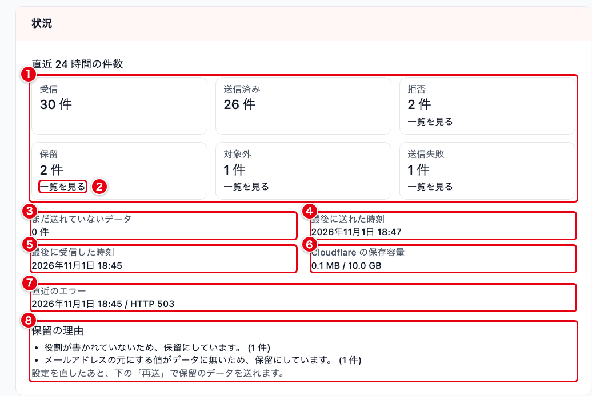

| 番号 | 項目 | 説明 |
| --- | --- | --- |
| ① | 直近 24 時間の件数 | 受信、送信済み、拒否、保留、対象外、送信失敗の件数です。受信の件数に、拒否したデータは入りません。送信済みは通常の送信で送れた件数で、再送で送った件数は含みません |
| ② | 一覧を見る | 件数が 1 件以上の拒否、保留、対象外、送信失敗に表示されます。押すと、その種類の「送れなかったデータ」の画面に移動します（「7. 送れなかったデータを確かめる」） |
| ③ | まだ送れていないデータ | まだ送信の処理が済んでいない件数と、そのうち最も古いデータを受信した日時です |
| ④ | 最後に送れた時刻 | CampusLA へ最後にデータを送れた日時です。まだ送れていなければ「まだありません」です |
| ⑤ | 最後に受信した時刻 | LMS からデータを最後に受け取った日時です |
| ⑥ | Cloudflare の保存容量 | この接続が Cloudflare で使っている保存容量と、上限の 10.0 GB です |
| ⑦ | 直近のエラー | CampusLA へ送れずに、待ったり送信を止めたりしたときの、最後のエラーの日時と、CampusLA の応答（HTTP の状態コード）などです。CampusLA がデータの内容を受け付けず「送信失敗」にしたときは、ここには記録されません。記録が一度も無ければ表示されません |
| ⑧ | 保留の理由 | 保管している保留のデータの、理由ごとの件数です。24 時間より前に保留になったデータも数えます。保留が 1 件も無ければ表示されません |

③は、送信を一時停止している間や CampusLA へ送れていない間は、保留や対象外になったデータも数えます。

⑦は、エラーのあとで送れるようになっても消えません。
④の日時が⑦の日時より後なら、そのエラーのあとに送れています。

CampusLA へ送れないとき、らくらくLRS転送サービスは CampusLA の応答に応じて次のように扱います。

| CampusLA の応答 | 扱い |
| --- | --- |
| 受け付けた（2xx） | 送れたものとして先へ進みます |
| データの内容を受け付けない（400、409、413） | まとめて送ったデータを分けて送り直し、受け付けられなかったデータだけを「送信失敗」にして、残りを送ります |
| 認証の誤り（401、403） | 送信を止め、15 分ごとに試します |
| 別の場所への転送（3xx） | 転送先へは送らず、送信を止め、15 分ごとに試します |
| 証明書を確かめられない | 送信を止め、15 分ごとに試します |
| 一時的な失敗（429、5xx、404、405 などの上にない応答、通信の失敗、時間切れ） | 1 分後から、間隔を倍に延ばしながら最長 1 時間おきに試します。429 に `Retry-After` が付いていれば、その秒数（1 秒から 1 時間）待ちます。回数の上限はありません |

送信を止めている間は、状況の欄の上に赤い枠で理由が表示されます。
理由は「CampusLA の認証情報が違います」「送信先の証明書を確かめられません。送信を止めています」「送信先の設定を確かめてください」のどれかで、その下に次に自動で試す日時が表示されます。
設定を直して保存すると、15 分を待たずにすぐ試します。

一時的な失敗が同じデータで続くときは、まとめて送る件数を減らしながら、どのデータが原因かを確かめます。
特定の 1 件だけが受け付けられ続けないと分かったときは、そのデータを「送信失敗」にして、後ろのデータを送ります。

Cloudflare から状況を取得できないときは、「状況を取得できません。しばらくしてからもう一度開いてください。」と表示されます。

## 7. 送れなかったデータを確かめる

状況の欄の「一覧を見る」を押すと、「送れなかったデータ」の画面が開きます。
図は、保留のデータを表示したところです。

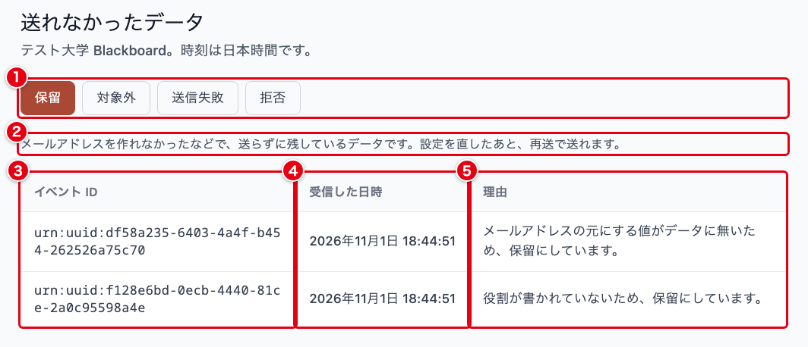

| 番号 | 項目 | 説明 |
| --- | --- | --- |
| ① | 種類 | 保留、対象外、送信失敗、拒否を切り替えます |
| ② | 種類の説明 | 選んでいる種類のデータが、どういうものかの説明です |
| ③ | イベント ID | LMS が送ったイベントの `id` です。LMS の記録と突き合わせるときに使います。`id` が無かったデータは「(ID なし)」と表示されます |
| ④ | 受信した日時 | データを受け取った日時です（日本時間） |
| ⑤ | 理由 | 送らなかった理由です |

「ゆるく確かめる」の接続では、LMS の `id` が `urn:uuid:` で始まる UUID ではなかったデータに、送信失敗の一覧で、`id` から作った `urn:uuid:` で始まる ID が表示されることがあります。
この ID は、LMS の記録にはありません。
「保存したデータを読み取れませんでした」のデータは、常に「(ID なし)」と表示されます。

新しく受け取ったものから順に、50 件ずつ表示されます。
51 件以上あるときは、「さらに古いものを見る」で続きを表示します。
データの中身（学習者の名前やメールアドレスなど）は表示されません。

拒否と保留と対象外の理由は、[Caliper から xAPI への変換](lrs-relay/caliper-xapi-conversion.md) の「拒否するイベント」と「保留の理由」にあります。
再送で見直した拒否のデータが、形は正しくなったものの送れなかったときは、拒否の一覧に残り、理由が「再送で見直したところ形は正しくなりましたが、メールアドレスの元にする値がデータに無いため送っていません。」や「送る形に変換できませんでした。」のように書き換わります（「8. 再送する」）。
送信失敗の理由は次のとおりです。

| 画面に表示される理由 | 送信失敗にした場合 |
| --- | --- |
| CampusLA が、データの内容を受け付けませんでした。 | CampusLA が 400 を返した |
| CampusLA にすでに同じデータがあり、内容が食い違っています。 | CampusLA が 409 を返した。同じ ID で中身の違うデータが CampusLA にある |
| データが大きすぎて、CampusLA が受け付けませんでした。 | 1 件だけで送っても CampusLA が 413 を返した |
| このデータは何度送っても受け付けられなかったため、送るのをやめました。 | 一時的な失敗が、このデータでだけ続いた |
| 保存したデータを読み取れませんでした。 | Cloudflare に保存したデータを読み取れなかった |
| 送る形に変換できませんでした。 | 再送で作り直したとき、xAPI の形にならなかった |

## 8. 再送する

接続の詳細の画面の「再送」の欄で、期間を選んで CampusLA へ送り直します。
送れなかったデータを、設定を直したあとに送るときや、CampusLA 側でデータが失われたときに使います。

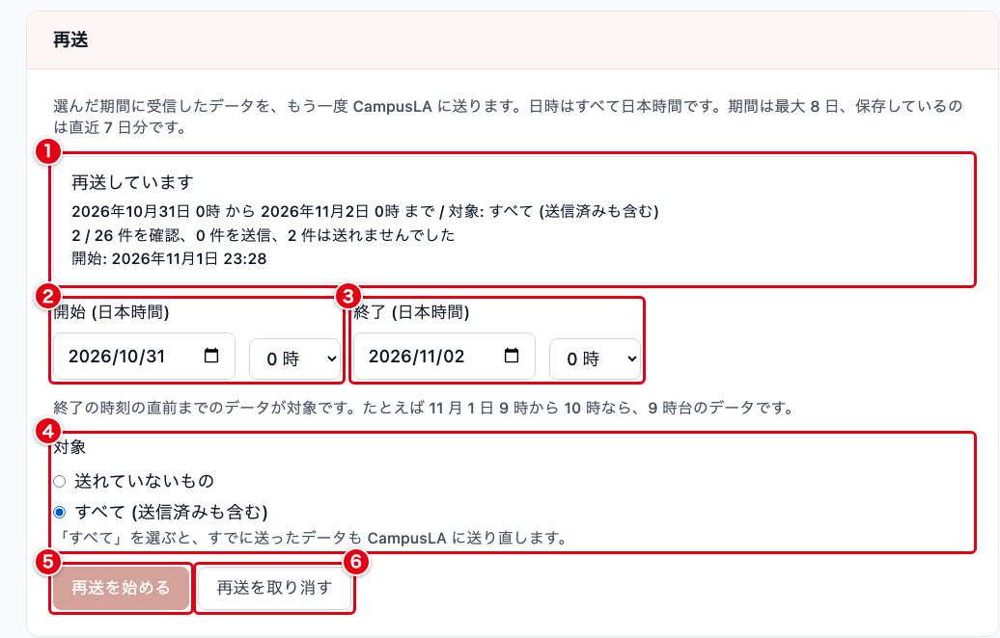

| 番号 | 項目 | 必須 | 説明 |
| --- | --- | :---: | --- |
| ① | 再送の状況 | | 「再送はしていません」「再送しています」「再送が終わりました」「再送を取り消しました」のどれかです。再送したことがあれば、期間と対象、確認した件数、送った件数、送れずに残った件数、開始と終了の日時も表示されます。再送している間は 5 秒ごとに更新されます |
| ② | 開始 (日本時間) | ✓ | 再送する期間の始まりの日付と時です |
| ③ | 終了 (日本時間) | ✓ | 再送する期間の終わりの日付と時です。終わりの時刻の直前までに受け取ったデータが対象です |
| ④ | 対象 | ✓ | 「送れていないもの」か「すべて (送信済みも含む)」を選びます。初期値は「送れていないもの」です |
| ⑤ | 再送を始める | | 再送を始めます。再送している間は押せません |
| ⑥ | 再送を取り消す | | 再送をやめます。「再送を取り消します。すでに送った分は元に戻りません。よろしいですか。」と確認が表示されます |

期間は 1 時間単位で、受け取った日時で選びます。
たとえば 11 月 1 日 9 時から 10 時を選ぶと、9 時台に受け取ったデータが対象です。
期間の初期値は、前の日の 0 時から、次の正時までです。
今の時間帯に受け取ったデータも、初期値のままで入ります。
図は、23 時台に画面を開き、期間は初期値のまま、対象を「すべて (送信済みも含む)」にして再送しているところです。
23 時台に開いたので、終了の初期値が翌日の 0 時になっています。

再送できる期間は最大 8 日です。
Cloudflare に残っているのは受け取ってから 7 日以内のデータなので、それより前のデータは送れません。
終了を開始より前にすると「終了は、開始より後の日時にしてください。」、8 日を超えると「再送できる範囲は、最大 8 日です。」と表示されます。

対象によって、送るデータが変わります。

| 対象 | 送るデータ |
| --- | --- |
| 送れていないもの | 期間内に受け取った、拒否、保留、対象外、送信失敗のデータです。保留、対象外、送信失敗のデータは、今の設定で作り直して送ります。拒否のデータは、受け取ったときと同じ Caliper の版の決まりと、今の検証の厳しさで確かめ直し、通ったものを今の設定で作り直して送ります。今の設定でも送れないデータは、送らずに残します |
| すべて (送信済みも含む) | 「送れていないもの」に加えて、期間内にすでに送ったデータも送ります。送ったデータは、前に送ったときの内容のまま送ります |

まだ送っていないデータ（「まだ送れていないデータ」に数えられているもの）は、再送を待たずに通常の送信で順に送ります。

「すべて」は、CampusLA 側でデータが失われたときに埋め戻すためのものです。
前に送ったデータと同じ ID、同じ内容で送ります。
CampusLA（SQL LRS）は、同じ ID で同じ内容のデータを受け取っても保存し直さないので、CampusLA に残っているデータは二重になりません。

①の「送れませんでした」の件数は、確かめたうちで送らずに残ったデータの数です。
保留、拒否、対象外、送信失敗のまま残ったデータを含みます。

再送で見直した拒否のデータは、形が正しくなっても、メールアドレスを作れないなどで送れないときは、拒否の一覧に残ります。
そのときの理由は、今の設定で受け取り直したときの理由（「再送で見直したところ形は正しくなりましたが、…」や「送る形に変換できませんでした。」）に書き換わります。
設定を直してから、もう一度再送してください。

再送は、通常の送信の合間に進めます。
送信を一時停止している間や、認証の誤りなどで送信を止めている間は、再送も待ちます。

1 つの接続で同時に動かせる再送は 1 つだけです。
ほかの方が再送を始めたあとに、前に開いた画面から「再送を始める」を押すと、次のように表示されます。

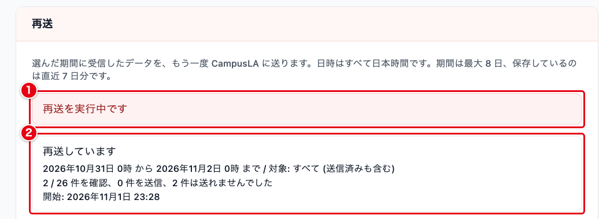

| 番号 | 項目 | 説明 |
| --- | --- | --- |
| ① | 再送を実行中です | すでに再送が動いているため、新しい再送を始めなかったことを表します。この表示は、再送が終わるか、「再送を取り消す」を押すか、期間や対象の入力を変えるまで残ります |
| ② | 再送の状況 | いま動いている再送の状況です |

新しく再送したいときは、今の再送が終わるのを待つか、「再送を取り消す」を押してから始めます。

## 9. 送信元を確かめる、追加する

接続の詳細の画面の「受信」の欄に、受け付ける送信元と、拒んだ送信元が表示されます。

許可する送信元の IP アドレスもホスト名も登録していない接続では、次のように表示されます。

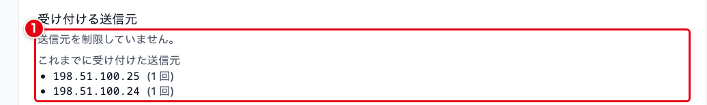

| 番号 | 項目 | 説明 |
| --- | --- | --- |
| ① | 受け付ける送信元 | 「送信元を制限していません。」と表示され、その下に「これまでに受け付けた送信元」として、データを受け付けた IP アドレスと回数が表示されます |

LMS がどの IP アドレスから送ってくるかが分かったら、そのアドレスを許可する送信元に登録すると、ほかの送信元からのデータを受け付けなくなります。

許可する送信元の IP アドレスかホスト名を登録している接続では、次のように表示されます。

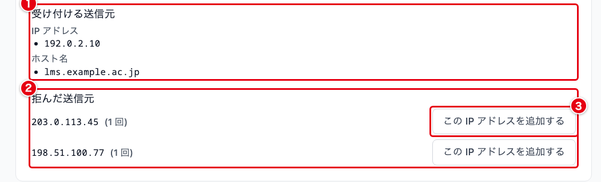

| 番号 | 項目 | 説明 |
| --- | --- | --- |
| ① | 受け付ける送信元 | 登録している IP アドレスとホスト名の一覧です。登録していない方は表示されません |
| ② | 拒んだ送信元 | 許可していない送信元から届いたときの、送信元の IP アドレスと回数です |
| ③ | この IP アドレスを追加する | その IP アドレスを、許可する送信元の IP アドレスに追加します |

回数は、同じ IP アドレスについて 1 時間に 1 回までしか数えません。
送信元の記録は、最後に届いてから 7 日たつと消えます。
一覧には最大 50 件が表示されます。

「この IP アドレスを追加する」を押すと、「◯◯ を受け付ける送信元に追加しました。Cloudflare への反映を始めています。」と表示されます。
追加したあとも、その IP アドレスは、最後に拒んでから 7 日たつまで「拒んだ送信元」に残ります。
許可する送信元の IP アドレスが 50 件に達しているときは追加できず、「受け付ける送信元は 50 件までです。使っていない送信元を接続の編集で外してから、もう一度追加してください。」と表示されます。

## 10. 接続を編集する、削除する

### 接続を編集する

接続の詳細の画面で「設定を編集する」を押すと、接続の編集画面が開きます。
この画面の見出しは「接続を編集」です。
入力欄は「1. 接続を作る」と同じです。
「保存する」を押すと「設定を保存しました。Cloudflare への反映を始めています。」と表示され、Cloudflare へ反映されます。

CampusLA の API キーと秘密キーの欄は、接続の編集画面では空欄で表示されます。
空欄のまま保存すると、今のキーがそのまま使われます。
**送信先の URL のホスト名やポート、または送信先の IP アドレスを変えるときは、API キーと秘密キーも入れ直す必要があります。**
入れ直さずに保存すると「送信先を変える場合は、API キーと秘密キーも入れ直してください。」と表示されます。
今のキーが、新しい送信先へ送られないようにするためです。

### 接続を削除する

接続の詳細の画面の「接続の削除」の欄で「この接続を削除する」を押すと、「「◯◯」を削除します。Cloudflare 上のデータもすべて消えます。よろしいですか。」と確認が表示されます。

**接続を削除すると、Cloudflare に溜まっているデータと設定もすべて消えます。**
まだ CampusLA へ送っていないデータも失われます。
削除した接続は元に戻せません。

Cloudflare 上のデータを消せなかったときは、「Cloudflare 上のデータを削除できませんでした。接続は削除していません。しばらくしてからもう一度お試しください。」と表示され、接続は残ります。

## データの保管

受け取ったデータ（LMS が送った Caliper と、変換した xAPI）と接続の設定は、Cloudflare 上に暗号化（AES-256-GCM）して保管します。
保管する場所は北東アジアを目安に指定していますが、日本国内に限る指定ではありません。

受け取ったデータは、受け取ってから 7 日たつと消えます。
CampusLA へ送れていないデータと、拒否、保留、対象外、送信失敗のデータも、同じく 7 日で消えます。
消す処理は 1 時間ごとに行います。

学習データは SEC のサーバを通らず、SEC には保存しません。
SEC が保存するのは、接続の設定、受信用の API キーから計算した値と末尾 4 文字、暗号化した CampusLA の API キーと秘密キーです。

送れていないデータが消える前には、通知先へお知らせのメールを送ります（[通知先と通知メール](lrs-relay/lrs-relay-notifications.md)）。

## よくある質問

### Q. ダッシュボードにらくらくLRS転送サービスが表示されません

このサービスは、ダッシュボードのサービス一覧には表示されません。
開き方は「ご利用の前に」に書いています。

### Q. 保留になったデータを送るには、どうすればよいですか

「送れなかったデータ」の画面で保留の理由を確かめ、接続の設定を直して保存してから、対象を「送れていないもの」にして再送します。
理由の見方は「7. 送れなかったデータを確かめる」、再送は「8. 再送する」に書いています。
受け取ってから 7 日たったデータは消えるので、それまでに再送してください。

### Q. 受信用の API キーが分からなくなりました

API キーは発行したときに 1 回だけ表示され、あとから確かめる方法はありません。
「API キーを再発行する」で新しい API キーを発行し、LMS の設定も変えてください。
手順は「2. 受信用の API キーを発行する」に書いています。

### Q. 「Cloudflare に未反映」と表示されたままです

反映は自動でやり直します。
表示されている案内の見方は「6. 状況を確かめる」の「「Cloudflare に未反映」と表示されたとき」に書いています。
